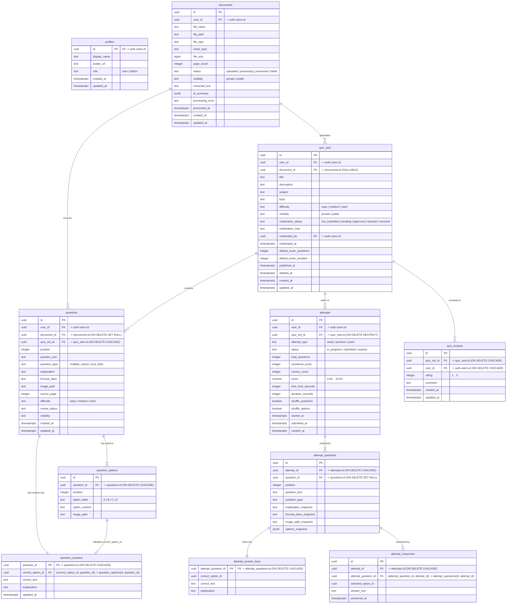

# THIẾT KẾ CƠ SỞ DỮ LIỆU (DATABASE DESIGN) — AI QUIZ STUDIO

## 1. Tổng quan Kiến trúc Database

Cơ sở dữ liệu của **AI Quiz Studio** được thiết kế trên nền tảng **Supabase PostgreSQL 15+**, tuân thủ nguyên tắc:
1. **Tương thích hoàn toàn với 4 bảng hiện có** (`documents`, `questions`, `question_options`, `question_answers`) — nâng cấp qua `ALTER TABLE`, tuyệt đối không sử dụng `DROP TABLE`.
2. **Mở rộng lên hệ thống 11 bảng hoàn chỉnh** phục vụ đầy đủ các luồng: Quản lý tài khoản & phân quyền (`profiles`), Tài liệu nguồn (`documents`), Bộ đề & Kiểm duyệt (`quiz_sets`), Ngân hàng câu hỏi & đáp án bảo mật (`questions`, `question_options`, `question_answers`), Lượt làm bài & Snapshot chống gian lận/bảo toàn lịch sử (`attempts`, `attempt_questions`, `attempt_answer_keys`, `attempt_responses`), và Đánh giá cộng đồng (`quiz_reviews`).
3. **Bảo toàn lịch sử thi (Immutability & Soft Delete)**:
   - Bảng `quiz_sets` sử dụng xóa mềm (`deleted_at`).
   - Bảng `attempts` tham chiếu `quiz_sets(id)` với `ON DELETE RESTRICT`.
   - Khi bắt đầu lượt làm bài (`start-attempt`), toàn bộ nội dung câu hỏi, danh sách lựa chọn (sau khi đã trộn ngẫu nhiên nếu có) và đáp án đúng tại thời điểm đó được **snapshot** sang `attempt_questions` và `attempt_answer_keys`. Dù chủ bộ đề sau đó có sửa hoặc xóa câu hỏi gốc, lịch sử bài thi và kết quả chấm điểm của người học vẫn giữ nguyên 100%.

---

## 2. Sơ đồ Quan hệ Thực thể (ERD)

---

## 3. Chi tiết 11 Bảng Dữ liệu

### 3.1. `profiles` (Tạo mới)
Quản lý hồ sơ người dùng và vai trò hệ thống.
- `id` (`UUID PRIMARY KEY REFERENCES auth.users(id) ON DELETE CASCADE`)
- `display_name` (`TEXT`)
- `avatar_url` (`TEXT`)
- `role` (`TEXT NOT NULL DEFAULT 'user' CHECK (role IN ('user', 'admin'))`)
- `created_at`, `updated_at` (`TIMESTAMPTZ NOT NULL DEFAULT now()`)
- **Trigger tự động**: `on_auth_user_created` tự động tạo bản ghi `profiles` với `role = 'user'` ngay khi người dùng đăng ký qua Supabase Auth.

### 3.2. `documents` (Bảng hiện có — nâng cấp qua `ALTER TABLE`)
Quản lý tài liệu gốc do người dùng tải lên (mặc định luôn `private`).
- Giữ nguyên: `id`, `user_id`, `file_name`, `file_path`, `file_type`, `status`, `created_at`, `visibility`.
- Bổ sung:
  - `mime_type` (`TEXT`): MIME type đã kiểm định.
  - `file_size` (`BIGINT CHECK (file_size > 0)`): Dung lượng file (bytes).
  - `page_count` (`INTEGER`): Số trang tài liệu (nếu là PDF).
  - `extracted_text` (`TEXT`): Nội dung văn bản trích xuất từ PDF/DOCX/TXT/OCR Ảnh để tái sử dụng khi tạo nhiều bộ đề từ một tài liệu.
  - `ai_summary` (`JSONB`): Tóm tắt cấu trúc, chủ đề chính, từ khóa do Gemini phân tích ở bước `process-document`.
  - `processing_error` (`TEXT`): Thông báo lỗi nếu xử lý AI thất bại.
  - `processed_at` (`TIMESTAMPTZ`), `updated_at` (`TIMESTAMPTZ NOT NULL DEFAULT now()`).

### 3.3. `quiz_sets` (Tạo mới)
Thực thể trung tâm quản lý bộ đề, chế độ hiển thị và quy trình kiểm duyệt (`both_admin`).
- `id` (`UUID PRIMARY KEY DEFAULT gen_random_uuid()`)
- `user_id` (`UUID NOT NULL REFERENCES auth.users(id) ON DELETE CASCADE`)
- `document_id` (`UUID NULL REFERENCES public.documents(id) ON DELETE SET NULL`): Cho phép nhiều `quiz_sets` cùng trỏ về 1 `document`, hoặc `NULL` nếu tạo bộ đề thủ công.
- `title` (`TEXT NOT NULL CHECK (char_length(trim(title)) > 0)`)
- `description`, `subject`, `topic` (`TEXT`)
- `difficulty` (`TEXT NOT NULL DEFAULT 'medium' CHECK (difficulty IN ('easy', 'medium', 'hard'))`)
- `visibility` (`TEXT NOT NULL DEFAULT 'private' CHECK (visibility IN ('private', 'public'))`)
- `moderation_status` (`TEXT NOT NULL DEFAULT 'not_submitted' CHECK (moderation_status IN ('not_submitted', 'pending', 'approved', 'rejected', 'removed'))`)
- `moderation_note` (`TEXT`), `moderated_by` (`UUID NULL REFERENCES auth.users(id)`), `moderated_at` (`TIMESTAMPTZ`)
- `default_exam_questions` (`INTEGER NOT NULL DEFAULT 60 CHECK (default_exam_questions > 0)`)
- `default_exam_duration` (`INTEGER NOT NULL DEFAULT 60 CHECK (default_exam_duration > 0)`) — tính bằng phút.
- `published_at`, `deleted_at` (`TIMESTAMPTZ NULL`)
- `created_at`, `updated_at` (`TIMESTAMPTZ NOT NULL DEFAULT now()`)

### 3.4. `questions` (Bảng hiện có — nâng cấp qua `ALTER TABLE`)
- Giữ nguyên tất cả cột hiện có (`id`, `user_id`, `document_id`, `question_text`, `question_type`, `explanation`, `formula_latex`, `image_path`, `source_page`, `difficulty`, `review_status`, `created_at`, `visibility`).
- Bổ sung:
  - `quiz_set_id` (`UUID REFERENCES public.quiz_sets(id) ON DELETE CASCADE`)
  - `position` (`INTEGER NOT NULL DEFAULT 1`)
  - `updated_at` (`TIMESTAMPTZ NOT NULL DEFAULT now()`)
- Điều chỉnh FK: `document_id` chuyển từ `ON DELETE NO ACTION` sang `ON DELETE SET NULL`.
- Lưu ý bảo mật: Cột `visibility` và `review_status` cũ không được dùng làm nguồn xác thực quyền Public mới; mọi quyền truy cập câu hỏi đều thông qua `quiz_sets`.

### 3.5. `question_options` (Bảng hiện có — nâng cấp qua `ALTER TABLE`)
- Giữ nguyên: `id`, `question_id`, `option_label`, `option_content`, `image_path`.
- Bổ sung:
  - `position` (`INTEGER NOT NULL DEFAULT 1`)
  - `CONSTRAINT uq_question_options_id_question_id UNIQUE (id, question_id)`
  - `CONSTRAINT uq_question_options_question_label UNIQUE (question_id, option_label)`

### 3.6. `question_answers` (Bảng hiện có — nâng cấp qua `ALTER TABLE`, Server-Only)
- Giữ nguyên: `question_id` (PK), `correct_option_id`, `correct_text`, `explanation`.
- Bổ sung:
  - `updated_at` (`TIMESTAMPTZ NOT NULL DEFAULT now()`)
  - **Composite Foreign Key**:
    `FOREIGN KEY (correct_option_id, question_id) REFERENCES public.question_options(id, question_id) ON DELETE RESTRICT DEFERRABLE INITIALLY DEFERRED`
    Ràng buộc này đảm bảo ở mức cơ sở dữ liệu rằng `correct_option_id` bắt buộc phải thuộc về đúng câu hỏi `question_id`.

### 3.7. `attempts` (Tạo mới)
Quản lý phiên học/thi (`study`, `practice`, `exam`).
- Công thức điểm chuẩn hóa: `score = ROUND((correct_count::NUMERIC / total_questions::NUMERIC) * 10.0, 2)` (thang điểm 10, tối đa 2 chữ số thập phân).

### 3.8. `attempt_questions` (Tạo mới)
Lưu snapshot câu hỏi và `options_snapshot` (`JSONB`) tại thời điểm bắt đầu làm bài.
- Ràng buộc `UNIQUE (id, attempt_id)` và `UNIQUE (attempt_id, position)`.
- Cột `explanation_snapshot` được giữ `NULL` khi `attempts.status = 'in_progress'` để chống lộ lời giải trong lúc đang thi, và chỉ được cập nhật tự động từ `attempt_answer_keys` ngay khi bài thi chuyển sang `submitted` hoặc `expired`.

### 3.9. `attempt_answer_keys` (Tạo mới — Server-Only)
Lưu snapshot đáp án đúng (`correct_option_id`, `correct_text`, `explanation`) của từng `attempt_question_id`. Hoàn toàn bị thu hồi quyền `SELECT` đối với `anon` và `authenticated`.

### 3.10. `attempt_responses` (Tạo mới)
Lưu câu trả lời của người học cho từng câu hỏi trong attempt.
- **Composite Foreign Key**:
  `FOREIGN KEY (attempt_question_id, attempt_id) REFERENCES public.attempt_questions(id, attempt_id) ON DELETE CASCADE`
  Đảm bảo người dùng không bao giờ gửi được câu trả lời cho một câu hỏi không thuộc chính attempt đó.
- Ràng buộc `UNIQUE (attempt_id, attempt_question_id)` hỗ trợ `UPSERT` khi người học thay đổi lựa chọn trước lúc nộp bài.

### 3.11. `quiz_reviews` (Tạo mới)
Lưu đánh giá (1–5 sao) và nhận xét cho các bộ đề Public đã được duyệt.
- Ràng buộc `UNIQUE (quiz_set_id, user_id)` đảm bảo mỗi người dùng chỉ đánh giá 1 lần trên mỗi bộ đề.

---

## 4. Triggers Nghiệp vụ & Stored Procedures (ACID Transactions)

1. **`trg_protect_profile_fields`**: Ngăn chặn tuyệt đối người dùng tự cập nhật `role = 'admin'`.
2. **`trg_enforce_quiz_set_moderation_rules` & `trg_questions_invalidate_approval`**:
   - Khi người dùng chuyển bộ đề sang `visibility = 'public'`, tự động đặt `moderation_status = 'pending'`.
   - Ngăn người dùng thường tự đặt `moderation_status` thành `approved`, `rejected`, `removed` hoặc sửa các trường `moderated_by`, `moderated_at`, `moderation_note`.
   - Khi một bộ đề đã `approved` bị chủ sở hữu chỉnh sửa thông tin hoặc thêm/sửa/xóa câu hỏi, lựa chọn, đáp án, trigger tự động chuyển `moderation_status` về `pending` để Admin kiểm duyệt lại.
3. **Các hàm RPC chạy trong Transaction (`SECURITY DEFINER`)**:
   - `rpc_create_quiz_with_questions`: Tạo `quiz_set`, `questions`, `question_options`, `question_answers` trong 1 transaction duy nhất. Nếu bất kỳ câu hỏi nào thiếu đáp án hợp lệ, toàn bộ transaction sẽ rollback.
   - `rpc_start_attempt`: Kiểm tra quyền truy cập, tạo `attempts`, chọn ngẫu nhiên câu hỏi & trộn đáp án, lưu snapshot vào `attempt_questions` và `attempt_answer_keys` trong 1 transaction.
   - `rpc_submit_attempt`: Khóa bản ghi `attempts` bằng `SELECT ... FOR UPDATE`, kiểm tra thời gian server, chấm điểm chính xác từ `attempt_answer_keys`, đảm bảo tính **idempotent** khi người dùng nhấn nộp bài nhiều lần.
